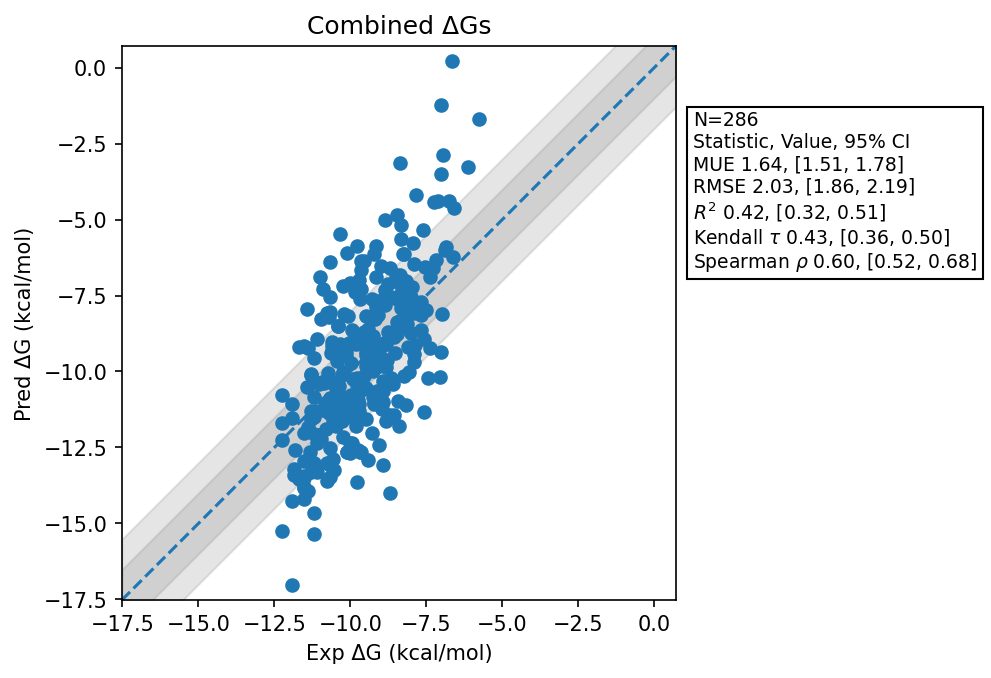

# Summary 2026 Aug 03
- Number of Datasets: 10
- Number of Ligands: 286
- Number of Edges: 493
- Total Wallclock Time: 59.37 Hours
- Average Time Per Edge: 0.12 Hours
- TMD Sha: [8f0552287cd876f4ebb7cf42b46585074fd2ef9c](https://github.com/tmd-industries/tmd/tree/8f0552287cd876f4ebb7cf42b46585074fd2ef9c)

## Description
Simulations ran with a 4fs timestep, with constraints enabled, simulating for 1 picosecond per frame to match the reference implementation.

## Dataset Metrics
| set | dataset | N | Kendall 𝜏 | MUE | RMSE | R² | Spearman ρ |
| :--- | :--- | :--- | :--- | :--- | :--- | :--- | :--- |
| jacs_set | Mcl1 | 42 | 0.56 | 2.13 | 2.59 | 0.67 | 0.76 |
| jacs_set | Jnk1 | 21 | 0.63 | 1.16 | 1.30 | 0.61 | 0.78 |
| jacs_set | P38 | 34 | 0.47 | 1.08 | 1.43 | 0.38 | 0.63 |
| miscellaneous_set | Cdk8 | 10 | 0.07 | 1.02 | 1.13 | 0.02 | 0.03 |
| merck | Cdk8 | 32 | 0.65 | 1.79 | 2.18 | 0.66 | 0.84 |
| merck | Pfkfb3 | 40 | 0.38 | 1.01 | 1.26 | 0.32 | 0.56 |
| merck | Hif2A Jmc2023 | 38 | 0.40 | 1.80 | 2.12 | 0.34 | 0.59 |
| merck | Hif2A | 41 | 0.11 | 2.40 | 2.70 | 0.05 | 0.15 |
| merck | Eg5 Charge 0 | 9 | 0.59 | 1.11 | 1.34 | 0.60 | 0.75 |
| merck | Eg5 Charge 1 | 19 | 0.30 | 1.78 | 2.02 | 0.16 | 0.42 |
