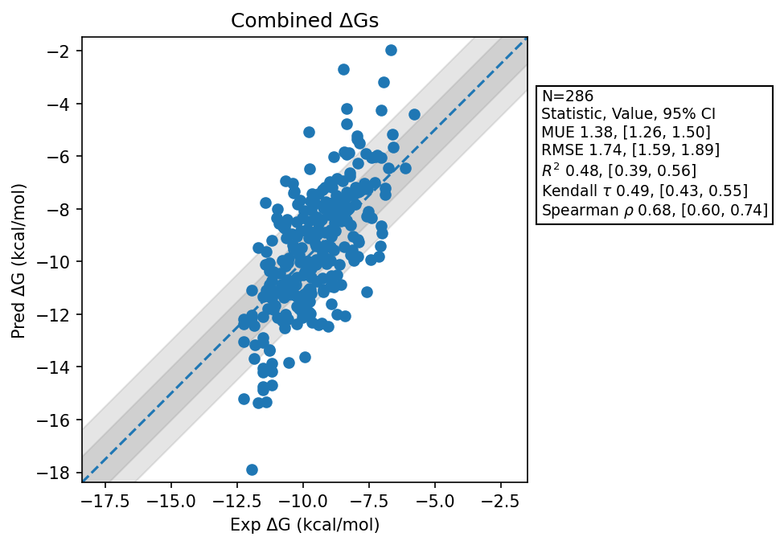

# Summary 2026 Aug 05
- Number of Datasets: 10
- Number of Ligands: 286
- Number of Edges: 493
- Total Wallclock Time: 118.12 Hours
- Average Time Per Edge: 0.24 Hours
- TMD Sha: [8f0552287cd876f4ebb7cf42b46585074fd2ef9c](https://github.com/tmd-industries/tmd/tree/8f0552287cd876f4ebb7cf42b46585074fd2ef9c)

## Description
Simulations ran with a 4fs timestep, with constraints enabled. Maintains 400 steps per frame, but reduces the frames from 2000 to 1250 to maintain 2ns of simulation.

## Dataset Metrics
| set | dataset | N | Kendall 𝜏 | MUE | RMSE | R² | Spearman ρ |
| :--- | :--- | :--- | :--- | :--- | :--- | :--- | :--- |
| merck | Pfkfb3 | 40 | 0.43 | 0.99 | 1.26 | 0.39 | 0.61 |
| merck | Eg5 Charge 0 | 9 | 0.48 | 0.96 | 1.12 | 0.59 | 0.70 |
| merck | Eg5 Charge 1 | 19 | 0.20 | 1.24 | 1.66 | 0.02 | 0.25 |
| merck | Hif2A Jmc2023 | 38 | 0.52 | 1.39 | 1.64 | 0.45 | 0.71 |
| merck | Cdk8 | 32 | 0.68 | 2.26 | 2.73 | 0.70 | 0.87 |
| merck | Hif2A | 41 | 0.23 | 1.49 | 1.77 | 0.15 | 0.35 |
| miscellaneous_set | Cdk8 | 10 | -0.07 | 1.19 | 1.55 | 0.01 | -0.12 |
| jacs_set | Jnk1 | 21 | 0.65 | 1.12 | 1.21 | 0.63 | 0.82 |
| jacs_set | Mcl1 | 42 | 0.45 | 1.60 | 1.95 | 0.45 | 0.65 |
| jacs_set | P38 | 34 | 0.52 | 0.98 | 1.27 | 0.52 | 0.70 |
