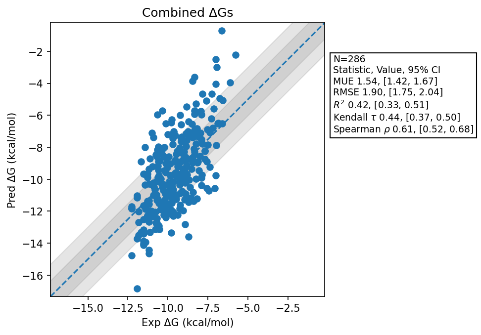

# Summary 2026 Aug 06
- Number of Datasets: 10
- Number of Ligands: 286
- Number of Edges: 493
- Total Wallclock Time: 64.17 Hours
- Average Time Per Edge: 0.13 Hours
- TMD Sha: [8f0552287cd876f4ebb7cf42b46585074fd2ef9c](https://github.com/tmd-industries/tmd/tree/8f0552287cd876f4ebb7cf42b46585074fd2ef9c)

## Description
Simulations ran with a 4fs timestep, with constraints enabled, simulating for 1 picosecond per frame to match the reference implementation. Ratio of local steps to global steps was reduced.

## Dataset Metrics
| set | dataset | N | Kendall 𝜏 | MUE | RMSE | R² | Spearman ρ |
| :--- | :--- | :--- | :--- | :--- | :--- | :--- | :--- |
| jacs_set | Mcl1 | 42 | 0.56 | 1.82 | 2.24 | 0.64 | 0.76 |
| jacs_set | Jnk1 | 21 | 0.63 | 1.45 | 1.58 | 0.62 | 0.79 |
| jacs_set | P38 | 34 | 0.43 | 1.00 | 1.28 | 0.40 | 0.61 |
| miscellaneous_set | Cdk8 | 10 | -0.11 | 1.10 | 1.27 | 0.00 | -0.16 |
| merck | Cdk8 | 32 | 0.64 | 1.68 | 2.09 | 0.63 | 0.83 |
| merck | Pfkfb3 | 40 | 0.33 | 1.03 | 1.32 | 0.24 | 0.48 |
| merck | Hif2A Jmc2023 | 38 | 0.45 | 1.72 | 1.98 | 0.39 | 0.64 |
| merck | Hif2A | 41 | 0.10 | 2.14 | 2.48 | 0.04 | 0.14 |
| merck | Eg5 Charge 0 | 9 | 0.42 | 1.12 | 1.38 | 0.52 | 0.54 |
| merck | Eg5 Charge 1 | 19 | 0.19 | 1.66 | 1.87 | 0.09 | 0.27 |
