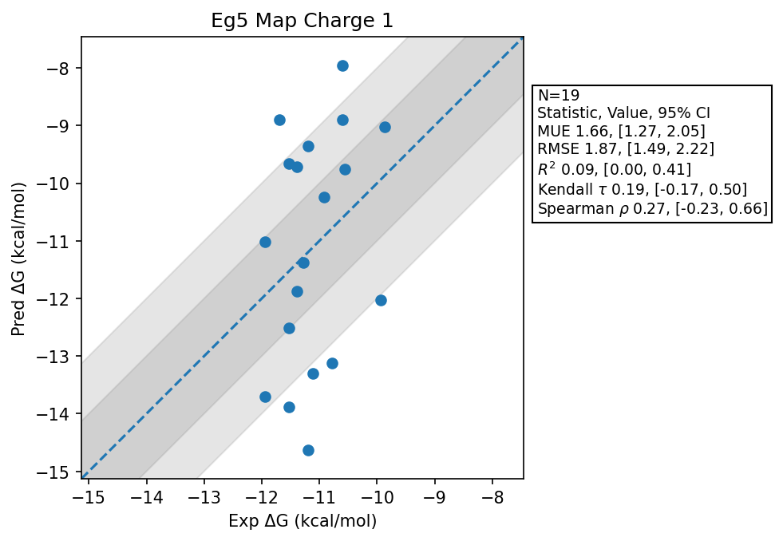

# Eg5 Map Charge 1

## Statistics Summary
- MUE: 1.66
- RMSE: 1.87
- R²: 0.09
- Kendall 𝜏: 0.19
- Spearman ρ: 0.27

## System Details
- Ligands: 19
- Host Atoms: 5906
- Map Details:
  - Edges: 29
  - Min Dummy Atoms: 5
  - Max Dummy Atoms: 36
  - Mean Dummy Atoms: 18.3
  - Median Dummy Atoms: 20.0

## Simulation Details
- TMD Sha: [8f0552287cd876f4ebb7cf42b46585074fd2ef9c](https://github.com/tmd-industries/tmd/tree/8f0552287cd876f4ebb7cf42b46585074fd2ef9c)
- GPU: RTX 5090, RTX 5080
- MPS Processes: 2
- Batch Mode: True
- Total Wallclock Time: 4.33 Hours
- Average Time Per Edge: 0.15 Hours
- Total Nanoseconds Simulated: 4794.40
- TMD Forcefield: smirnoff_2_0_0_amber_am1bcc.py
- Ligand Charges: Amber AM1BCC ELF10
- Simulation Details:
  - Seed: 814
  - Timestep (femptoseconds): 4.0
  - Equilibration Steps: 125000
  - Steps Per Frame: 250
  - Production Ns: 2
  - Target Overlap: 0.667
  - Water Sampling: True
  - REST: Temperature Scale 3.0
  - Local MD: Steps 240, Radius 1.2
