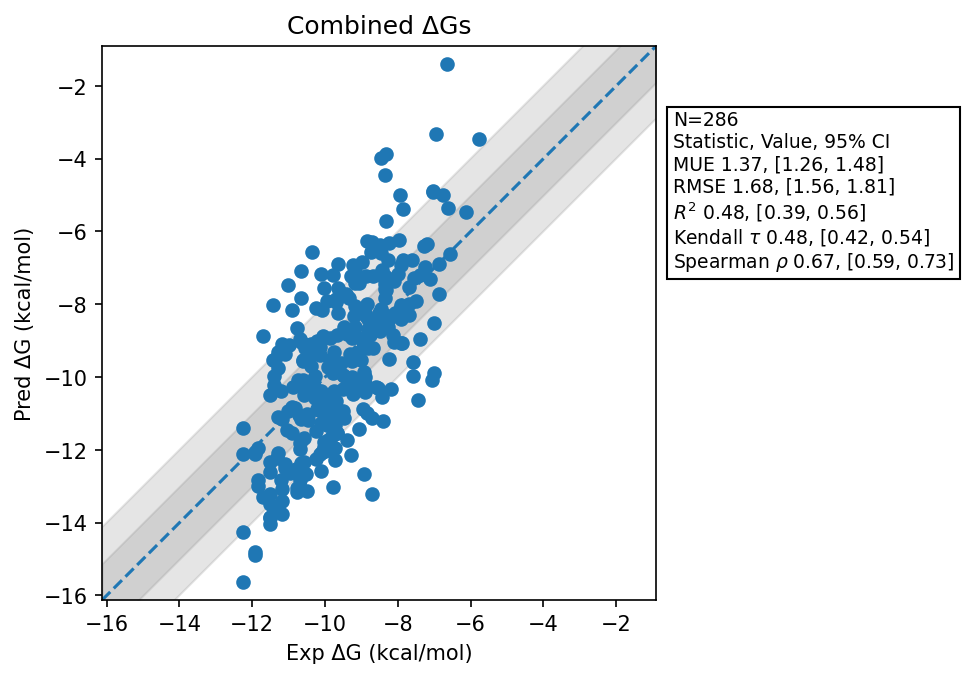

# Summary 2026 Aug 09
- Number of Datasets: 10
- Number of Ligands: 286
- Number of Edges: 493
- Total Wallclock Time: 76.38 Hours
- Average Time Per Edge: 0.15 Hours
- TMD Sha: [8f0552287cd876f4ebb7cf42b46585074fd2ef9c](https://github.com/tmd-industries/tmd/tree/8f0552287cd876f4ebb7cf42b46585074fd2ef9c)

## Description
Simulations ran with a 2.5fs timestep, without constraints enabled. Verifies that the chiral atom change and the terminal atom interpolation didn't impact performance.

## Notes:
- Uses the pre-constraint compatible maps to match the previous simulations.

## Dataset Metrics
| set | dataset | N | Kendall 𝜏 | MUE | RMSE | R² | Spearman ρ |
| :--- | :--- | :--- | :--- | :--- | :--- | :--- | :--- |
| jacs_set | Mcl1 | 42 | 0.55 | 1.33 | 1.74 | 0.58 | 0.75 |
| jacs_set | Jnk1 | 21 | 0.60 | 1.57 | 1.68 | 0.61 | 0.78 |
| jacs_set | P38 | 34 | 0.49 | 1.18 | 1.49 | 0.46 | 0.65 |
| miscellaneous_set | Cdk8 | 10 | 0.11 | 0.58 | 0.71 | 0.04 | 0.05 |
| merck | Cdk8 | 32 | 0.69 | 1.54 | 1.91 | 0.74 | 0.87 |
| merck | Pfkfb3 | 40 | 0.39 | 1.00 | 1.31 | 0.34 | 0.57 |
| merck | Hif2A Jmc2023 | 38 | 0.46 | 1.31 | 1.52 | 0.40 | 0.65 |
| merck | Hif2A | 41 | 0.14 | 1.85 | 2.17 | 0.07 | 0.20 |
| merck | Eg5 Charge 0 | 9 | 0.37 | 1.24 | 1.43 | 0.52 | 0.50 |
| merck | Eg5 Charge 1 | 19 | 0.31 | 1.59 | 1.78 | 0.13 | 0.37 |
