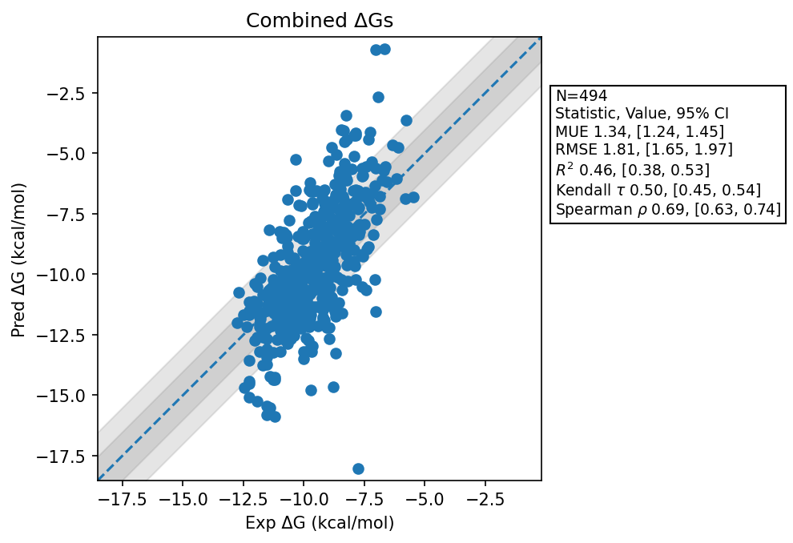

# Summary 2026 Aug 21
- Number of Datasets: 21
- Number of Ligands: 501
- Number of Edges: 861
- Total Wallclock Time: 100.83 Hours
- Average Time Per Edge: 0.12 Hours
- TMD Sha: [c000e4ca8782afb02dc29c798166a1f46edca6af](https://github.com/tmd-industries/tmd/tree/c000e4ca8782afb02dc29c798166a1f46edca6af)

## Description
Simulations ran with a 4fs timestep, with constraints. Verifies that the chiral atom change was the cause of the poor performance seen as part of `v0.5.1`.

## Notes:
- Uses the pre-constraint compatible maps to match the previous simulations.

## Dataset Metrics
| set | dataset | N | Kendall 𝜏 | MUE | RMSE | R² | Spearman ρ |
| :--- | :--- | :--- | :--- | :--- | :--- | :--- | :--- |
| jacs_set | Thrombin | 11 | 0.82 | 0.78 | 0.98 | 0.88 | 0.92 |
| jacs_set | Bace | 36 | 0.32 | 1.05 | 1.37 | 0.18 | 0.44 |
| jacs_set | Mcl1 | 42 | 0.52 | 1.74 | 2.30 | 0.51 | 0.70 |
| jacs_set | Jnk1 | 21 | 0.51 | 1.33 | 1.48 | 0.53 | 0.70 |
| jacs_set | Ptp1B | 23 | 0.53 | 1.80 | 2.76 | 0.35 | 0.65 |
| jacs_set | Tyk2 | 16 | 0.47 | 0.79 | 1.09 | 0.46 | 0.54 |
| jacs_set | Cdk2 | 16 | 0.70 | 0.46 | 0.63 | 0.82 | 0.87 |
| jacs_set | P38 | 34 | 0.40 | 0.99 | 1.22 | 0.37 | 0.60 |
| merck | Shp2 | 26 | 0.50 | 1.69 | 2.12 | 0.35 | 0.71 |
| merck | Cdk8 | 32 | 0.66 | 2.30 | 2.75 | 0.71 | 0.85 |
| merck | Pfkfb3 | 40 | 0.45 | 0.80 | 1.08 | 0.39 | 0.61 |
| merck | Cmet Charge 1 | 12 | 0.68 | 1.26 | 1.69 | 0.43 | 0.76 |
| merck | Cmet Charge 0 | 12 | 0.72 | 1.06 | 1.28 | 0.83 | 0.87 |
| merck | Hif2A Jmc2023 | 38 | 0.56 | 2.39 | 2.61 | 0.52 | 0.75 |
| merck | Tnks2 Charge 0 | 21 | 0.32 | 0.72 | 0.91 | 0.36 | 0.44 |
| merck | Tnks2 Charge 1 | 6 | 0.07 | 1.01 | 1.14 | 0.00 | 0.03 |
| merck | Syk Charge 0 | 40 | 0.46 | 0.62 | 0.88 | 0.39 | 0.61 |
| merck | Syk Charge -1 | 6 | 0.07 | 1.27 | 1.46 | 0.44 | 0.14 |
| merck | Hif2A | 41 | 0.12 | 1.71 | 2.05 | 0.06 | 0.18 |
| merck | Eg5 Charge 0 | 9 | 0.37 | 1.18 | 1.42 | 0.48 | 0.50 |
| merck | Eg5 Charge 1 | 19 | 0.21 | 1.12 | 1.47 | 0.07 | 0.26 |
