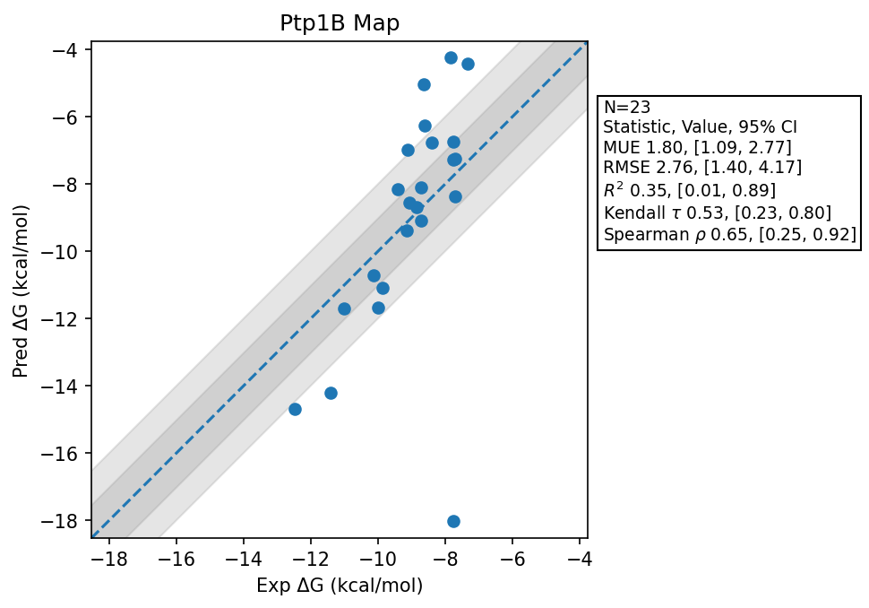

# Ptp1B Map

## Statistics Summary
- MUE: 1.80
- RMSE: 2.76
- R²: 0.35
- Kendall 𝜏: 0.53
- Spearman ρ: 0.65

## System Details
- Ligands: 23
- Host Atoms: 5488
- Map Details:
  - Edges: 41
  - Min Dummy Atoms: 2
  - Max Dummy Atoms: 30
  - Mean Dummy Atoms: 11.6
  - Median Dummy Atoms: 12.0

## Simulation Details
- TMD Sha: [c000e4ca8782afb02dc29c798166a1f46edca6af](https://github.com/tmd-industries/tmd/tree/c000e4ca8782afb02dc29c798166a1f46edca6af)
- GPU: RTX 5090, RTX 5080
- MPS Processes: 2
- Batch Mode: True
- Total Wallclock Time: 5.29 Hours
- Average Time Per Edge: 0.13 Hours
- Total Nanoseconds Simulated: 5606.00
- TMD Forcefield: smirnoff_2_0_0_amber_am1bcc.py
- Ligand Charges: Amber AM1BCC ELF10
- Simulation Details:
  - Seed: 618
  - Timestep (femptoseconds): 4.0
  - Equilibration Steps: 125000
  - Steps Per Frame: 250
  - Production Ns: 2
  - Target Overlap: 0.667
  - Water Sampling: True
  - REST: Temperature Scale 3.0
  - Local MD: Steps 244, Radius 1.2
