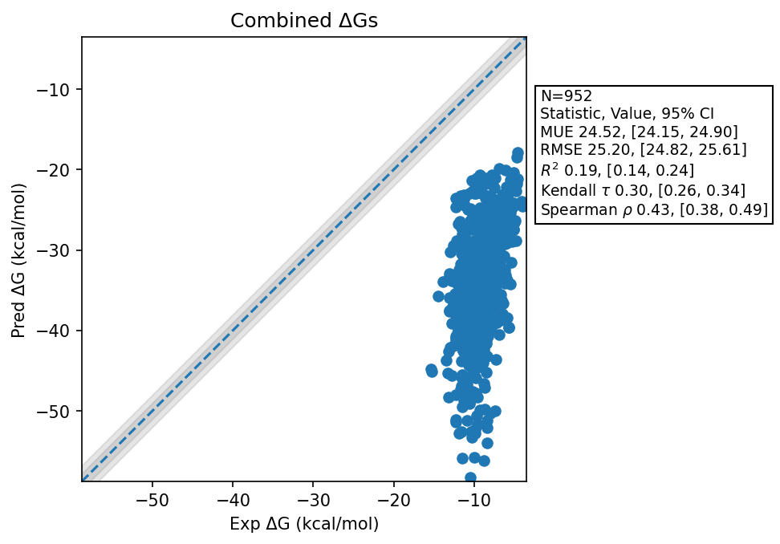

# Summary 2026 Jun 08 Abfe
- Number of Datasets: 64
- Number of Ligands: 1009
- Total Wallclock Time: 479.57 Hours
- Average Time Per Mol: 0.48 Hours
- TMD Sha: [e393f948bec757f86ae1d25908107665ac16b907](https://github.com/tmd-industries/tmd/tree/e393f948bec757f86ae1d25908107665ac16b907)

## Description
Initial experimental ABFE workflow benchmarks.

