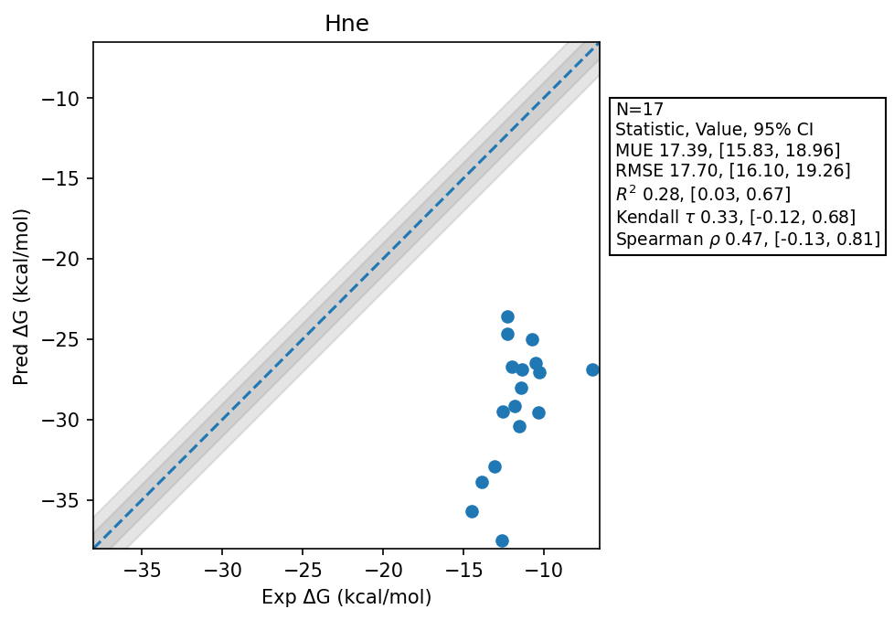

# Hne

## Statistics Summary
- MUE: 17.39
- RMSE: 17.70
- R²: 0.28
- Kendall 𝜏: 0.33
- Spearman ρ: 0.47

## System Details
- Ligands: 17
- Host Atoms: 3804

## Simulation Details
- TMD Sha: [e393f948bec757f86ae1d25908107665ac16b907](https://github.com/tmd-industries/tmd/tree/e393f948bec757f86ae1d25908107665ac16b907)
- GPU: RTX 4090
- MPS Processes: 2
- Batch Mode: True
- Total Wallclock Time: 7.09 Hours
- Average Time Per Molecule: 0.42 Hours
- Total Nanoseconds Simulated: 3185.20
- TMD Forcefield: smirnoff_2_0_0_amber_am1bcc.py
- Ligand Charges: Amber AM1BCC ELF10
- Simulation Details:
  - Seed: 608
  - Equilibration Steps: 200000
  - Steps Per Frame: 400
  - Production Ns: 2
  - Target Overlap: 0.667
  - Water Sampling: True
  - Local MD: Steps 390, Radius 1.2
