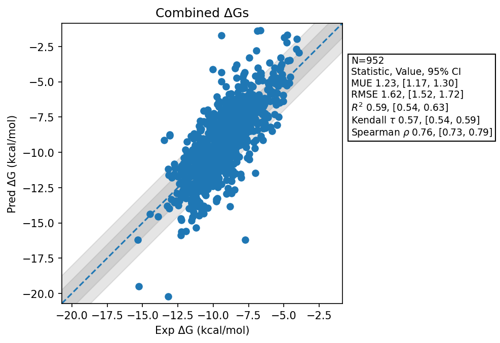

# Summary 2026 June 08
- Number of Datasets: 61
- Number of Ligands: 961
- Number of Edges: 1624
- Total Wallclock Time: 207.50 Hours
- Average Time Per Edge: 0.13 Hours
- TMD Sha: [7bfbc5dc44e1a1030ec36835a3e6d1725546d398](https://github.com/tmd-industries/tmd/tree/7bfbc5dc44e1a1030ec36835a3e6d1725546d398)

## Description
Evalutes changing the REST region to only include rings that are connected to dummy atoms (https://github.com/tmd-industries/tmd/pull/133)

## Dataset Metrics
| set | dataset | N | Kendall 𝜏 | MUE | RMSE | R² | Spearman ρ |
| :--- | :--- | :--- | :--- | :--- | :--- | :--- | :--- |
| jacs_set | Thrombin | 11 | 0.60 | 0.62 | 0.72 | 0.85 | 0.78 |
| jacs_set | Bace | 36 | 0.31 | 1.21 | 1.51 | 0.20 | 0.44 |
| jacs_set | Mcl1 | 42 | 0.48 | 1.45 | 1.90 | 0.44 | 0.66 |
| jacs_set | Jnk1 | 21 | 0.57 | 1.29 | 1.47 | 0.51 | 0.71 |
| jacs_set | Ptp1B | 23 | 0.53 | 1.29 | 2.14 | 0.32 | 0.65 |
| jacs_set | Tyk2 | 16 | 0.67 | 0.40 | 0.50 | 0.84 | 0.84 |
| jacs_set | Cdk2 | 16 | 0.58 | 0.66 | 0.76 | 0.67 | 0.79 |
| jacs_set | P38 | 34 | 0.48 | 1.05 | 1.36 | 0.49 | 0.65 |
| miscellaneous_set | Hiv1 Protease | 13 | -0.09 | 1.36 | 1.64 | 0.09 | -0.12 |
| miscellaneous_set | Faah | 24 | 0.40 | 1.58 | 1.80 | 0.57 | 0.51 |
| miscellaneous_set | Btk | 6 | 0.60 | 1.80 | 2.19 | 0.71 | 0.71 |
| miscellaneous_set | Cdk8 | 10 | 0.11 | 1.55 | 1.82 | 0.01 | 0.14 |
| miscellaneous_set | Malt1 | 16 | 0.47 | 1.58 | 1.78 | 0.52 | 0.59 |
| miscellaneous_set | Galectin | 26 | 0.50 | 0.90 | 1.24 | 0.60 | 0.70 |
| janssen_bace | Keranen P2 | 12 | 0.08 | 0.61 | 0.71 | 0.08 | 0.11 |
| janssen_bace | Bace Ciordia Prospective | 9 | 0.78 | 1.28 | 1.76 | 0.48 | 0.88 |
| janssen_bace | Bace P3 Arg368 In | 21 | 0.22 | 1.62 | 1.84 | 0.16 | 0.32 |
| janssen_bace | Ciordia Retro | 32 | 0.59 | 1.01 | 1.31 | 0.62 | 0.79 |
| water_set | Chk1 | 13 | -0.43 | 2.29 | 2.97 | 0.03 | -0.45 |
| water_set | Thrombin | 21 | 0.35 | 0.93 | 1.14 | 0.29 | 0.50 |
| water_set | Scyt Dehyd | 7 | 0.52 | 2.10 | 2.63 | 0.64 | 0.71 |
| water_set | Urokinase | 4 | 0.67 | 0.69 | 0.73 | 0.59 | 0.80 |
| water_set | Hsp90 Woodhead | 4 | 0.33 | 1.30 | 1.41 | 0.51 | 0.60 |
| water_set | Hsp90 Kung | 11 | 0.60 | 2.04 | 2.61 | 0.53 | 0.78 |
| water_set | Taf12 | 8 | 0.29 | 0.63 | 0.78 | 0.14 | 0.29 |
| water_set | Brd4 | 8 | 0.14 | 1.35 | 1.69 | 0.02 | -0.02 |
| gpcrs | A2A | 25 | 0.55 | 1.72 | 2.34 | 0.57 | 0.72 |
| gpcrs | P2Y1 Ortho Sub | 12 | 0.75 | 1.19 | 1.46 | 0.92 | 0.88 |
| gpcrs | P2Y1 Meta Sub | 20 | 0.38 | 1.05 | 1.47 | 0.40 | 0.54 |
| merck | Shp2 | 26 | 0.16 | 1.66 | 2.09 | 0.11 | 0.23 |
| merck | Cdk8 | 32 | 0.68 | 1.89 | 2.16 | 0.73 | 0.86 |
| merck | Pfkfb3 | 40 | 0.43 | 0.93 | 1.19 | 0.38 | 0.62 |
| merck | Cmet Charge 1 | 12 | 0.58 | 1.31 | 1.74 | 0.38 | 0.67 |
| merck | Cmet Charge 0 | 12 | 0.66 | 1.15 | 1.46 | 0.82 | 0.78 |
| merck | Hif2A Jmc2023 | 38 | 0.59 | 1.63 | 1.84 | 0.58 | 0.78 |
| merck | Tnks2 Charge 0 | 21 | 0.55 | 0.57 | 0.80 | 0.60 | 0.73 |
| merck | Tnks2 Charge 1 | 6 | 0.47 | 0.60 | 0.68 | 0.45 | 0.66 |
| merck | Syk Charge 0 | 40 | 0.03 | 1.19 | 1.45 | 0.03 | 0.01 |
| merck | Syk Charge -1 | 6 | 0.07 | 0.85 | 1.18 | 0.71 | 0.09 |
| merck | Hif2A | 41 | 0.17 | 1.63 | 1.94 | 0.11 | 0.26 |
| merck | Eg5 Charge 0 | 9 | 0.54 | 0.88 | 1.09 | 0.72 | 0.74 |
| merck | Eg5 Charge 1 | 19 | 0.33 | 0.87 | 1.02 | 0.22 | 0.44 |
| mcs_docking_set | Renin | 29 | 0.38 | 1.41 | 1.86 | 0.26 | 0.51 |
| mcs_docking_set | Hne Charge -1 | 2 | 1.00 | 0.17 | 0.17 | 1.00 | 1.00 |
| mcs_docking_set | Hne Charge 0 | 14 | 0.76 | 0.69 | 0.84 | 0.82 | 0.88 |
| schrodinger_macrocycles | Mht1 | 3 | 1.00 | 1.06 | 1.18 | 0.87 | 1.00 |
| schrodinger_macrocycles | 2Ep9 | 4 | 0.67 | 0.92 | 1.11 | 0.06 | 0.80 |
| schrodinger_macrocycles | 3Rkz | 7 | 0.62 | 1.31 | 1.40 | 0.60 | 0.71 |
| schrodinger_macrocycles | Hsp90 | 10 | 0.56 | 0.83 | 1.01 | 0.70 | 0.73 |
| scaffold_hopping_set | Bace1 | 3 | 1.00 | 1.77 | 1.92 | 0.71 | 1.00 |
| bayer_macrocycles | Ftase | 5 | 0.40 | 0.94 | 0.98 | 0.22 | 0.50 |
| bayer_macrocycles | Brd4 | 3 | 1.00 | 0.55 | 0.66 | 0.89 | 1.00 |
| fragments | Hsp90 Single Ring | 7 | 0.49 | 0.77 | 0.94 | 0.39 | 0.63 |
| fragments | Mup1 | 6 | 1.00 | 0.82 | 0.96 | 0.97 | 1.00 |
| fragments | Hsp90 2Rings | 6 | 0.73 | 1.33 | 1.47 | 0.43 | 0.83 |
| fragments | Mcl1 | 12 | 0.18 | 0.76 | 0.93 | 0.21 | 0.24 |
| fragments | Jak2 Set1 | 10 | 0.64 | 0.54 | 0.72 | 0.76 | 0.77 |
| fragments | P38 | 6 | 0.60 | 1.10 | 1.37 | 0.83 | 0.77 |
| fragments | T4 Lysozyme | 12 | 0.55 | 0.79 | 0.96 | 0.62 | 0.72 |
| fragments | Jak2 Set2 | 8 | 0.57 | 1.96 | 2.38 | 0.51 | 0.76 |
| fragments | Liga | 11 | 0.78 | 1.64 | 2.09 | 0.94 | 0.90 |
