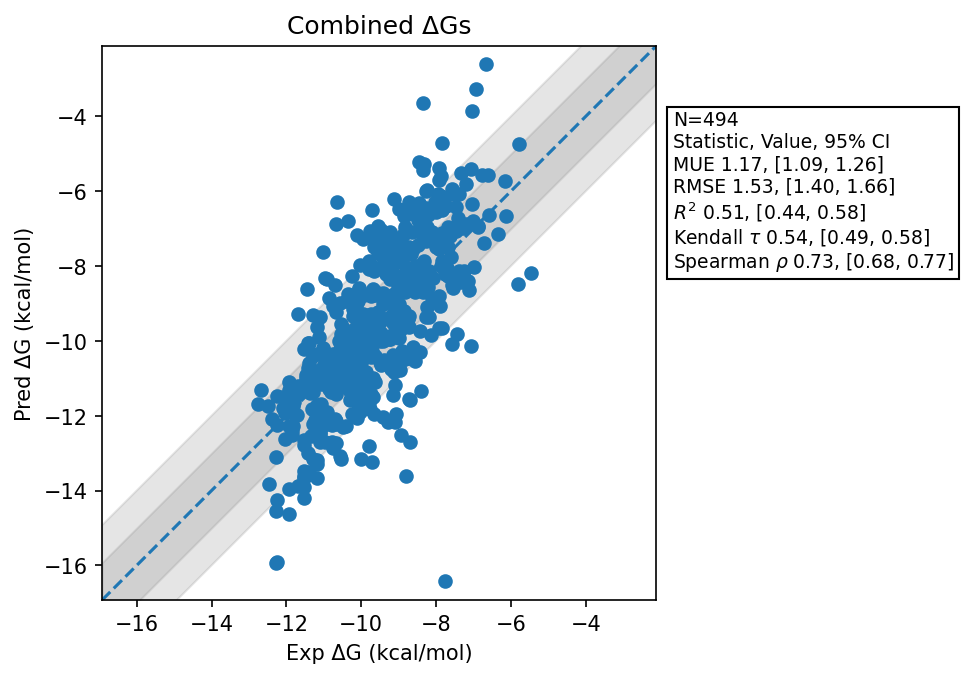

# Summary 2026 Sept 19
- Number of Datasets: 21
- Number of Ligands: 501
- Number of Edges: 860
- Total Wallclock Time: 102.18 Hours
- Average Time Per Edge: 0.12 Hours
- TMD Sha: [c4fbbffa1e2473414827fd473bca80feaa9865bb](https://github.com/tmd-industries/tmd/tree/c4fbbffa1e2473414827fd473bca80feaa9865bb)

## Description
Simulations ran with a 4fs timestep, with constraints. Reduces the force threshold for intermediate states to avoid forces that blow up with a larger timestep.

## Dataset Metrics
| set | dataset | N | Kendall 𝜏 | MUE | RMSE | R² | Spearman ρ |
| :--- | :--- | :--- | :--- | :--- | :--- | :--- | :--- |
| jacs_set | Thrombin | 11 | 0.78 | 0.59 | 0.82 | 0.90 | 0.90 |
| jacs_set | Bace | 36 | 0.25 | 1.24 | 1.53 | 0.16 | 0.37 |
| jacs_set | Mcl1 | 42 | 0.55 | 1.21 | 1.58 | 0.54 | 0.75 |
| jacs_set | Jnk1 | 21 | 0.63 | 1.30 | 1.43 | 0.56 | 0.77 |
| jacs_set | Ptp1B | 23 | 0.56 | 1.32 | 2.15 | 0.31 | 0.67 |
| jacs_set | Tyk2 | 16 | 0.68 | 0.45 | 0.59 | 0.79 | 0.83 |
| jacs_set | Cdk2 | 16 | 0.55 | 0.71 | 0.90 | 0.83 | 0.75 |
| jacs_set | P38 | 34 | 0.52 | 1.10 | 1.51 | 0.46 | 0.70 |
| merck | Shp2 | 26 | 0.35 | 1.57 | 1.87 | 0.17 | 0.49 |
| merck | Cdk8 | 32 | 0.75 | 1.67 | 1.94 | 0.78 | 0.91 |
| merck | Pfkfb3 | 40 | 0.42 | 1.08 | 1.42 | 0.34 | 0.62 |
| merck | Cmet Charge 1 | 12 | 0.58 | 1.19 | 1.50 | 0.40 | 0.67 |
| merck | Cmet Charge 0 | 12 | 0.66 | 1.08 | 1.40 | 0.84 | 0.79 |
| merck | Hif2A Jmc2023 | 38 | 0.54 | 1.31 | 1.49 | 0.52 | 0.74 |
| merck | Tnks2 Charge 0 | 21 | 0.49 | 0.60 | 0.83 | 0.56 | 0.62 |
| merck | Tnks2 Charge 1 | 6 | 0.07 | 0.65 | 0.73 | 0.33 | 0.20 |
| merck | Syk Charge 0 | 40 | 0.28 | 0.68 | 0.89 | 0.22 | 0.38 |
| merck | Syk Charge -1 | 6 | 0.33 | 0.74 | 0.99 | 0.74 | 0.49 |
| merck | Hif2A | 41 | 0.18 | 1.75 | 2.07 | 0.10 | 0.26 |
| merck | Eg5 Charge 0 | 9 | 0.54 | 1.00 | 1.17 | 0.71 | 0.71 |
| merck | Eg5 Charge 1 | 19 | 0.21 | 1.35 | 1.53 | 0.08 | 0.28 |
