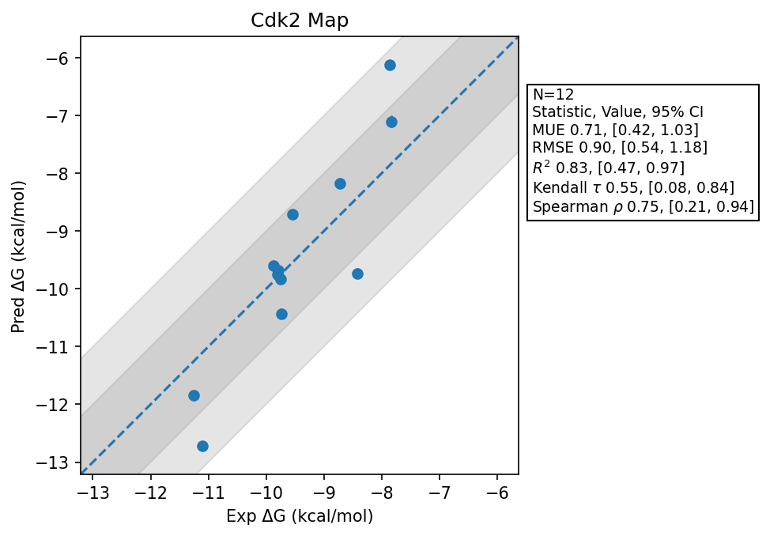

# Cdk2 Map

## Statistics Summary
- MUE: 0.71
- RMSE: 0.90
- R²: 0.83
- Kendall 𝜏: 0.55
- Spearman ρ: 0.75

## System Details
- Ligands: 16
- Host Atoms: 9028
- Map Details:
  - Edges: 28
  - Min Dummy Atoms: 1
  - Max Dummy Atoms: 11
  - Mean Dummy Atoms: 6.1
  - Median Dummy Atoms: 6.0

## Simulation Details
- TMD Sha: [c4fbbffa1e2473414827fd473bca80feaa9865bb](https://github.com/tmd-industries/tmd/tree/c4fbbffa1e2473414827fd473bca80feaa9865bb)
- GPU: RTX 5090, RTX 5080
- MPS Processes: 1
- Batch Mode: True
- Total Wallclock Time: 3.31 Hours
- Average Time Per Edge: 0.12 Hours
- Total Nanoseconds Simulated: 2333.60
- TMD Forcefield: smirnoff_2_0_0_amber_am1bcc.py
- Ligand Charges: Amber AM1BCC ELF10
- Simulation Details:
  - Seed: 262
  - Timestep (femptoseconds): 4.0
  - Equilibration Steps: 125000
  - Steps Per Frame: 250
  - Production Ns: 2
  - Target Overlap: 0.667
  - Water Sampling: True
  - REST: Temperature Scale 3.0
  - Local MD: Steps 240, Radius 1.2
