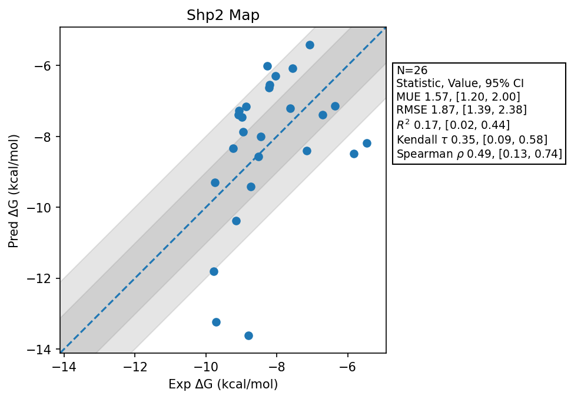

# Shp2 Map

## Statistics Summary
- MUE: 1.57
- RMSE: 1.87
- R²: 0.17
- Kendall 𝜏: 0.35
- Spearman ρ: 0.49

## System Details
- Ligands: 26
- Host Atoms: 8422
- Map Details:
  - Edges: 46
  - Min Dummy Atoms: 1
  - Max Dummy Atoms: 27
  - Mean Dummy Atoms: 9.0
  - Median Dummy Atoms: 7.0

## Simulation Details
- TMD Sha: [c4fbbffa1e2473414827fd473bca80feaa9865bb](https://github.com/tmd-industries/tmd/tree/c4fbbffa1e2473414827fd473bca80feaa9865bb)
- GPU: RTX 5090, RTX 5080
- MPS Processes: 2
- Batch Mode: True
- Total Wallclock Time: 7.62 Hours
- Average Time Per Edge: 0.17 Hours
- Total Nanoseconds Simulated: 5674.00
- TMD Forcefield: smirnoff_2_0_0_amber_am1bcc.py
- Ligand Charges: Amber AM1BCC ELF10
- Simulation Details:
  - Seed: 262
  - Timestep (femptoseconds): 4.0
  - Equilibration Steps: 125000
  - Steps Per Frame: 250
  - Production Ns: 2
  - Target Overlap: 0.667
  - Water Sampling: True
  - REST: Temperature Scale 3.0
  - Local MD: Steps 240, Radius 1.2
